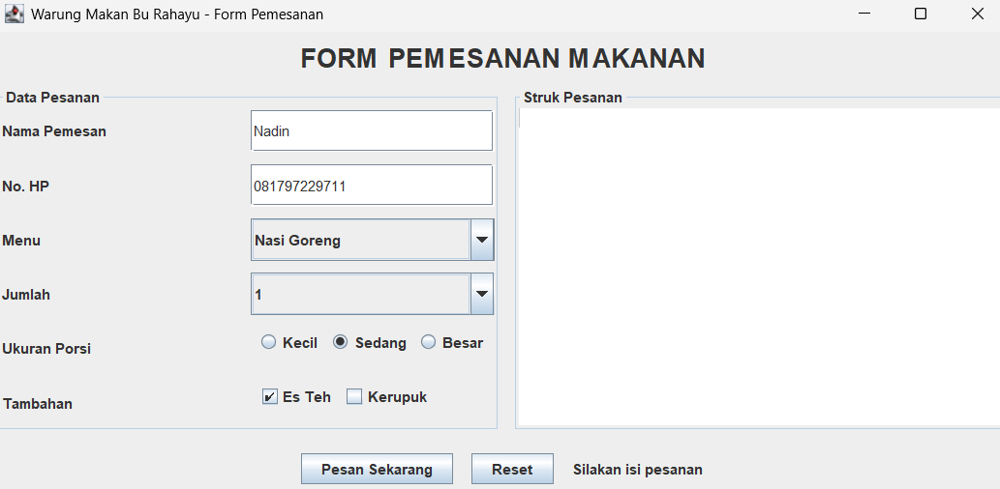
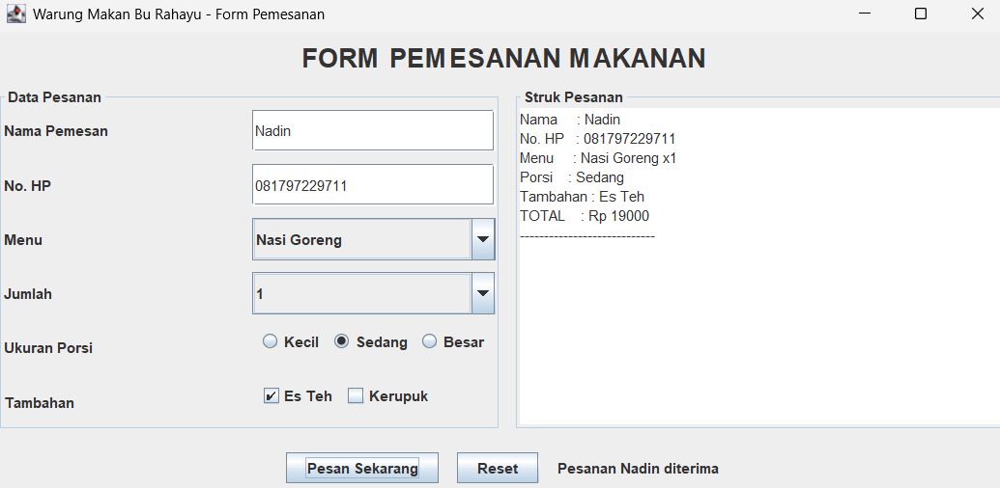
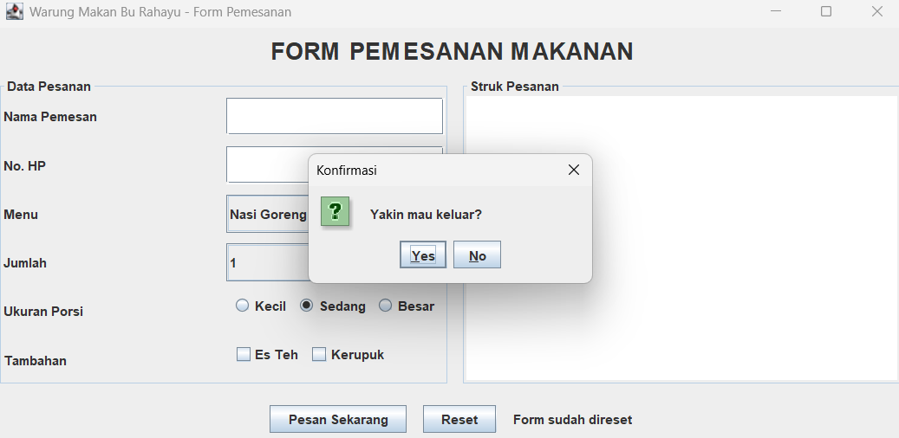

# Latihan GUI Java - Form Pemesanan Makanan

Program Swing sederhana buat pesan makanan di warung. Isi nama dan no. HP, pilih menu, jumlah, porsi, dan tambahan, lalu klik **Pesan Sekarang** dan struknya muncul di sebelah kanan.

## 5 Komponen utama GUI yang dipakai

1. **Top-level container**: `JFrame`, jadi window utama yang menampung semua komponen lain.
2. **Intermediate container**: `JPanel` buat ngelompokin komponen (form, pilihan porsi, tombol), dan `JScrollPane` biar area struk bisa di-scroll.
3. **Atomic component**: komponen dasar yang langsung dipakai user.
   - `JLabel` untuk teks keterangan
   - `JTextField` untuk input nama dan no. HP
   - `JComboBox` untuk pilih menu dan jumlah
   - `JRadioButton` untuk pilih ukuran porsi (cuma bisa satu)
   - `JCheckBox` untuk pilih tambahan (boleh lebih dari satu)
   - `JButton` untuk tombol Pesan dan Reset
   - `JTextArea` untuk menampilkan struk
4. **Layout**: buat ngatur posisi komponen.
   - `BorderLayout` untuk frame utama (judul atas, form kiri, struk tengah, tombol bawah)
   - `GridLayout` untuk form (label kiri, input kanan)
   - `FlowLayout` untuk pilihan radio/checkbox dan tombol yang berjajar ke samping
5. **Event listener**: buat nanganin aksi user.
   - `ActionListener` (interface) untuk klik tombol Pesan dan Reset, method-nya `actionPerformed`
   - `MouseAdapter` (adapter class) supaya warna tombol berubah saat mouse lewat
   - `KeyAdapter` (adapter class) supaya kolom No. HP cuma bisa diisi angka
   - `WindowAdapter` (adapter class) buat muncul konfirmasi saat window mau ditutup

## Screenshot

